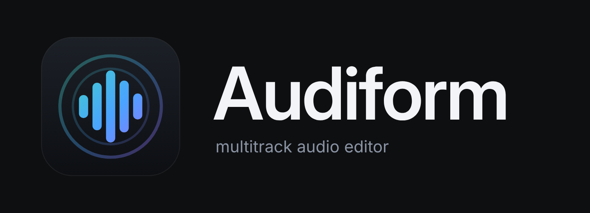
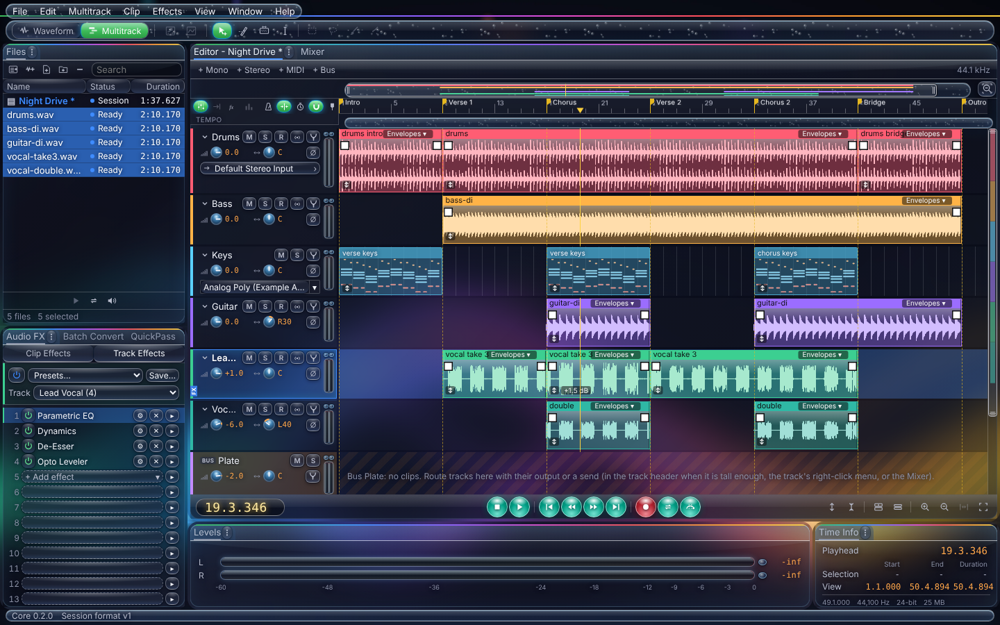

<p align="center">
  <picture>
    <source media="(prefers-color-scheme: light)" srcset="brand/logo/logo-light.png">
    
  </picture>
</p>

<p align="center">
  A free, open-source multitrack audio editor for podcasts, voiceover, music and immersive mixes.<br>
  Built on <a href="https://github.com/geekcastradio/altered-audio-editor">Altered Audio Editor</a> by Steve Phillips and The GeekCast Radio Network.
</p>

## Built on Altered Audio Editor

Audiform is a fork of [Altered Audio Editor](https://github.com/geekcastradio/altered-audio-editor), created by **Steve Phillips** and **The GeekCast Radio Network, LLC** ([thegcrn.com](https://thegcrn.com/)). Almost everything you see here started with them: the two-editor design, the multitrack and Waveform editors, sessions and libraries, recording, the effect chain and its effects (Voice Chain there, FX Chain in Audiform), QuickPass, Batch Convert, Loudness Match, Music Fit, the podcast workflow, the privacy rules, and the care that went into all of it. Audiform exists because their work made a great foundation to build on.

If Audiform is useful to you, please consider supporting the original project too:

- Read Steve's book, [*Altered Audio: Podcasting Demystified*](https://www.barnesandnoble.com/w/altered-audio-steve-phillips/1147888459).
- Support the original author at [paypal.me/scp21](https://paypal.me/scp21).
- Follow Altered Audio Editor at [github.com/geekcastradio/altered-audio-editor](https://github.com/geekcastradio/altered-audio-editor).

Audiform moves faster and tries new directions (3D audio, MIDI, automation). Everything in it is offered back: Altered Audio Editor is welcome to take any of it (see [Contributing](#contributing)).

**Please report Audiform problems here, in [Audiform's issues](https://github.com/nwh212/audiform/issues), not to the Altered Audio Editor project.** Audiform is not made or endorsed by The GeekCast Radio Network.

> Status: in active development. Pre-release: keep backups of your recordings.




<p>
  
  
</p>


## Download

Windows 10 and 11 (64-bit). Get the latest build from the [Releases page](https://github.com/nwh212/audiform/releases), then pick one file under Assets:

- **`Audiform-<version>-setup.exe`** is the installer. It adds a Start menu entry and an uninstaller, and works per user or for all users.
- **`Audiform-<version>-portable.zip`** needs no install. Unzip it anywhere, including a USB drive, and run the app.
- **`SHA256SUMS.txt`** lists a checksum for each file so you can confirm your download is intact.

The app is not code signed yet, so Windows SmartScreen may say it does not recognize it. Choose More info, then Run anyway. Builds are made by GitHub Actions from the tagged source, so what you download matches what is in this repository.

A few antivirus scanners may flag the installer with a low-confidence guess. That is common for new, unsigned installers and goes away as the file builds a reputation. To check your copy, compare its SHA-256 with `SHA256SUMS.txt` (in PowerShell: `Get-FileHash <file>`).

**Linux and macOS (experimental).** Releases also carry a Linux AppImage and `.deb`, and a macOS `.dmg` for Apple silicon Macs. They are built from the same source but not tested much yet, so reports are welcome. The macOS app is not notarized: the first time, right-click it and choose Open. AAC export works on Windows only for now.

Early versions are pre-releases. Expect rough edges and keep backups of your recordings.

**Coming from Altered Audio Editor?** Audiform opens the same session, template, library and shortcut files, and the first time it starts it copies your Altered Audio Editor settings (preferences, shortcuts, workspaces, plug-in list). Both apps can be installed side by side.

## What Audiform adds

- **3D Space sessions:** place each track and bus in a room instead of panning it, hear it on stereo speakers or headphones (binaural), and export to any speaker layout (5.1, 7.1, 7.1.2, 7.1.4 and more) as a multichannel WAV, or to stereo. Per track: height (above and below ear level), size, spread, width, rotation, spatialize (opens a stereo sound into the surrounds and heights) and an LFE send. Levels and the Mixer show every speaker channel.
- **Automation lanes:** volume, pan, any effect setting and every 3D Space setting over time, drawn under each track.
- **MIDI:** MIDI tracks with VST3 instruments, a piano roll with easy zoom and scroll, notes in the track's color.
- **Metronome and tempo:** a Metronome track, tempo and time signature changes, bars and beats on the ruler and snapping to them.
- **Amp Model:** plays neural amp captures (`.nam`) with a gate, tone, level match and cabinet.
- **New effects and editors:** Parametric EQ graph editor, Phase Curve, Shaped Noise Reducer, Opto Leveler, Tube Preamp.
- **Plug-ins:** plug-ins from one maker can share a process so they can talk to each other, plug-ins get the song position, optional real-time mixdown, Effects > Plug-ins lists what you scanned.
- **Workflow:** several sessions open at once, clip level handles, side-by-side drops of many files, and many smaller fixes.

## What it does today (from Altered Audio Editor)

- **Multitrack editing:** move, razor, slip and time-selection tools; trim, split, merge, loop and copy clips; fades and crossfades; clip volume and pan envelopes; markers; ripple delete.
- **Waveform editor:** open any file on its own to cut, silence, amplify and fade it, try an FX Chain on it as a live preview and apply it to the selection or the whole file (undoable), then save it in place as WAV, FLAC or MP3, or as a new file.
- **Opens what call recorders export:** WAV (including 8-bit and ADPCM), FLAC, MP3, AAC/M4A, ALAC, Ogg Vorbis, Ogg FLAC and Opus. Insert Files as Tracks puts each speaker's file on its own track, straight from the downloaded zip.
- **Spectrum and pitch views:** see frequencies over time, select an unwanted sound (a whistle, a buzz, a chair squeak) with a box, lasso or brush and reduce, remove or repair just that, leaving the voice under it alone. Spot Repair fills a painted click or cough from the audio around it.
- **Audio drivers:** the system driver everywhere, and ASIO on Windows (release builds), with every input channel of an interface pickable per track.
- **Recording:** arm tracks, pick each one's input, and record them to their own files while the session plays. Punch in over a time selection with pre-roll, and set a latency offset so takes line up. On Windows, a "System audio" input records what the computer plays, such as a call, next to your mics.
- **FX Chain:** up to 16 effects on any clip or track, heard live and included in every export: Parametric EQ, Hum Cut, Dynamics, Limiter, Breath Gate, De-Esser, Speech Leveler, Gain, Noise Reducer, Noise Print Reducer and Sound Eraser (both learn from a selection), Hiss Reducer, Room Reducer, Click Repair, Clip Repair, DC Offset Fix, Band EQ (10, 20 or 30 bands), Curve EQ (drag its points on the graph), Notch Filter, Precision Filter (Butterworth, Chebyshev, Bessel or Elliptic), Center Remover, Phase Rotate (phase angle, per-channel polarity and a fine delay, to line up tracks that partly cancel) and Pitch Shift. Each effect's settings open in their own movable window, and any setting can move over time: draw its points on the clip, like a volume envelope. Sliders change the sound as you drag, without stopping playback, and meters show the track chain's level in and out. EQs and filters draw their response. Start from presets like Podcast Voice or Voice Over and save your own.
- **Playback:** live mixing with per-track volume, pan, mute, solo and polarity; Loop Playback and Skip Selection; stereo meters on every track with peak hold and clip lights.
- **Libraries:** keep your show's intros, outros, promos and ads in one place and drag them straight onto tracks.
- **Mixdown and stems:** export the session, a selection or each track as WAV (4-bit ADPCM, 8, 16, 24 or 32-bit float), FLAC MP3 (constant or variable bit rate) or AAC/M4A (on Windows) at any sample rate, with a loudness check (LUFS and true peak). File > Export > Multitrack Session (.sesx) writes a copy for editors that read that format (tracks, clips, levels and fades; effects stay behind).
- **Loudness Match:** set each clip or track to a podcast, platform or broadcast target in one step. Broadcast targets follow your region (US by default).
- **QuickPass:** scan for silences, short noises, clicks, clipping or the parts with sound. Remove silences (keeping a short natural pause), turn them down, split or mark them; repair clicks and clipped peaks into a copy of the clip's audio so the original is never touched. Comes with presets and saves your own.
- **Time stretch:** fit a clip to an exact length (a 15, 30 or 60 second ad slot, or a time selection) keeping the pitch, or change speed and pitch together like tape.
- **Music Fit:** make a music bed an exact length without changing its speed. It cuts out or repeats whole sections where the music lines up, keeps the intro and ending, and leaves the joins as editable crossfades. Offers up to three plans that join in different places, and says where each one joins.
- **Phase Align:** line up two recordings of the same voice (a host mic and a room mic, a camera and a recorder) to the sample, flipping polarity when needed.
- **Chapters:** chapter markers export as a timestamp list for video descriptions, a CSV spreadsheet, or podcast chapters JSON, and are written into exported MP3 and FLAC files.
- **Batch Convert:** turn a folder of files into WAV, FLAC, MP3 or AAC in one go, optionally running a Voice Chain preset on each, then normalizing the peak and fading the ends, with naming, a destination folder, sample rate, channel and dither settings, per-file progress, and tags copied across or set for every file (WAV, FLAC, MP3 and M4A).
- **Speaker Balance and host profiles:** level every voice track to the quietest in one click before processing, and start each host's track from a Close Mic, Standard Mic or Remote Guest profile.
- **Settings:** zoom, fades, colors, output device, autosave, solo, meter colors, recording offset, time format loudness defaults, session backups and a record count-in in one place (Edit > Settings).
- **Session templates:** start every episode from your show's track layout.
- **Imports `.sesx` sessions:** brings in tracks, clips and positions from `.sesx` multitrack session files.

## Private by design

- No account and no login. Ever.
- No telemetry, analytics or tracking. The app makes no network calls on its own.
- Update checks are off unless you turn them on.
- Your audio never leaves your computer.

## Support the original project

Audiform is free. If it helps you, please support the people it is built on: [paypal.me/scp21](https://paypal.me/scp21) supports Steve Phillips, the author of Altered Audio Editor, and his book is [*Altered Audio: Podcasting Demystified*](https://www.barnesandnoble.com/w/altered-audio-steve-phillips/1147888459).

## Contributing

Bug fixes and features are welcome through pull requests. See [CONTRIBUTING.md](CONTRIBUTING.md).

**For Altered Audio Editor:** everything in Audiform is also offered to The GeekCast Radio Network, LLC under the terms of its [Contributor License Agreement](CLA.md), so any change here can be merged into Altered Audio Editor. Audiform stays a GitHub fork of it to make that easy. Report security problems privately as described in [SECURITY.md](SECURITY.md).

Thanks to Steve Phillips and The GeekCast Radio Network for Altered Audio Editor, and to everyone listed in [CONTRIBUTORS.md](CONTRIBUTORS.md).

## Build from source (Windows)

First time on this machine? Follow [docs/setup-windows.md](docs/setup-windows.md). It covers installing Rust, Node and the Microsoft build tools step by step.

Then, from the repo folder:

```powershell
npm install
npm run tauri dev
```

## Checks

These are the same checks CI runs. Run them before every commit.

```powershell
npm run check
npm test
npm run build
cd src-tauri
cargo fmt --check
cargo clippy --all-targets -- -D warnings
cargo test
```

## File formats

Every file the app writes is versioned JSON with a `format` and `schema_version` header. Schemas live in [`/schemas`](schemas). Audiform keeps Altered Audio Editor's formats and ids, so files move freely between the two.

| File | Format id | Extension |
| --- | --- | --- |
| Session | `altaudio.session` | `.altaudio` |
| Library index | `altaudio.library` | `library.json` |
| Session template | `altaudio.template` | `.altemplate` |
| Workspace | `altaudio.workspace` | `.alworkspace` |
| Host voice profile | `altaudio.host_profile` | `.alhost` |
| Keyboard shortcuts | `altaudio.keymap` | `.alkeys` |

## Project docs

- [CLAUDE.md](CLAUDE.md): scope, phase plan, architecture and clean-room rules.
- [NOTICE.md](NOTICE.md): what Audiform is based on and how it was changed.
- [docs/decisions.md](docs/decisions.md): architecture decisions log.
- [docs/design-principles.md](docs/design-principles.md): what stays familiar, what is our own, and the no-AI-unless-you-turn-it-on rule.
- [ATTRIBUTION.md](ATTRIBUTION.md): credits for any adapted third-party code.

## License

Copyright (c) The GeekCast Radio Network, LLC (Altered Audio Editor).
Copyright (c) The Audiform contributors (changes since October 2026).

Licensed under the GNU General Public License v3.0 or later. See [LICENSE](LICENSE) and [NOTICE.md](NOTICE.md).

"Altered Audio Editor" and its logo are trademarks of The GeekCast Radio Network, LLC, used here only to say what Audiform is based on, as their [trademark notice](TRADEMARKS.md) allows. Audiform has its own name and artwork. Audiform is independent and not affiliated with or endorsed by The GeekCast Radio Network or any other software company.
